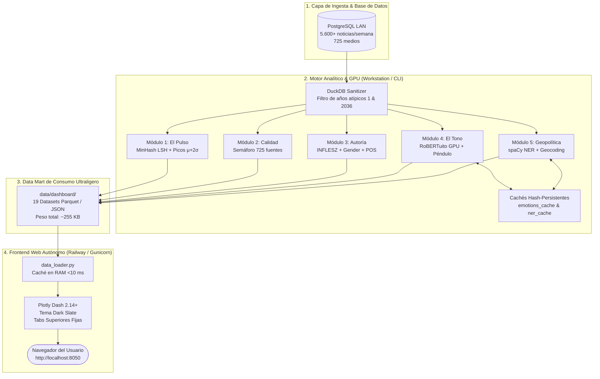

# NewsPulse 📡 • Monitoreo de Prensa Escrita & Inteligencia Editorial

[](https://www.python.org/)
[](https://dash.plotly.com/)
[](https://duckdb.org/)
[](https://pytorch.org/)
[](https://huggingface.co/pysentimiento/robertuito-emotion-analysis)
[](https://spacy.io/)
[](https://railway.app/)
[](https://opensource.org/licenses/MIT)

**NewsPulse** es una plataforma analítica y de inteligencia editorial integral diseñada para monitorear, auditar y explorar la prensa escrita digital en Chile y Latinoamérica. 

La plataforma aborda el ciclo completo del dato: desde la extracción y sanitización de más de **5.600 noticias semanales** provenientes de **725 medios digitales** mediante DuckDB, pasando por la inferencia de *Deep Learning* en GPU (RoBERTuito y spaCy NER), hasta la presentación interactiva en una aplicación web en **Plotly Dash** con diseño contemporáneo *Dark Slate*, 100% desacoplada y lista para despliegue ligero en la nube (Railway).

---

## 📑 Tabla de Contenidos

1. [Arquitectura y Decisiones Críticas de Ingeniería](#-arquitectura-y-decisiones-críticas-de-ingeniería)
2. [Estructura del Corpus y Datos Utilizados](#-estructura-del-corpus-y-datos-utilizados)
3. [Módulos Analíticos y Métricas Expuestas](#-módulos-analíticos-y-métricas-expuestas)
   - [1. El Pulso Informativo (Velocidad, Sindicación y Rupturas)](#1-el-pulso-informativo-velocidad-sindicación-y-rupturas)
   - [2. Calidad de Datos & Observabilidad del Scraping](#2-calidad-de-datos--observabilidad-del-scraping)
   - [3. Autoría, Diversidad y Complejidad Editorial](#3-autoría-diversidad-y-complejidad-editorial)
   - [4. El Tono de la Cobertura (Emociones, Sensacionalismo y Prospectiva)](#4-el-tono-de-la-cobertura-emociones-sensacionalismo-y-prospectiva)
   - [5. Inteligencia Geopolítica & Radar de Actores](#5-inteligencia-geopolítica--radar-de-actores)
4. [El Data Mart Pre-agregado (data/dashboard/)](#-el-data-mart-pre-agregado-datadashboard)
5. [La Interfaz Web en Plotly Dash](#-la-interfaz-web-en-plotly-dash)
6. [Instalación y Guía de Uso Local](#-instalación-y-guía-de-uso-local)
7. [Despliegue Autónomo en Producción (Railway)](#-despliegue-autónomo-en-producción-railway)
8. [Verificación y Suite de Pruebas](#-verificación-y-suite-de-pruebas)
9. [Autoría y Contacto](#-autoría-y-contacto)

---

## 🏛️ Arquitectura y Decisiones Críticas de Ingeniería

El proyecto implementa el principio de **desacoplamiento total** entre el motor de procesamiento pesado y el servicio web:



### Decisiones de Diseño Fundamentales:
1. **Desacoplamiento Operacional (Zero Cloud Database Cost)**:
   - La base de datos PostgreSQL de scraping reside en red local privada. El servidor web de Dash **no se conecta a la base de datos**.
   - El pipeline exporta un *Data Mart* consolidado de **19 datasets Parquet/JSON que pesan tan solo 254.95 KB**.
   - La aplicación web en Railway consume menos de **150 MB de memoria RAM**, arranca en menos de 3 segundos y opera sin requerir GPU ni exponer puertos de bases de datos internas.
2. **Sanitización de Datos Reales (Defensive Data Engineering)**:
   - Descarte determinístico de fechas corruptas del scraper (e.g., año `0001` límite de PostgreSQL o año `2036` por fallos de parseo RSS).
   - Manejo diferenciado de cadenas vacías (`""`) vs. valores nulos (`NULL`) en leads y cuerpos.
3. **Checkpoints y Cachés Persistentes por Hash**:
   - Los modelos de PLN intensivos en GPU (RoBERTuito y spaCy NER) almacenan inferencias indexadas por el hash SHA-256 del contenido (`data/cache/emotions_cache.parquet` y `data/cache/ner_cache.parquet`). Si se reejecuta el pipeline, solo se procesan las noticias estrictamente nuevas.
4. **Sistema de Diseño Perceptual (Anti-Chartjunk)**:
   - Basado en los principios de `dashboard-ui-engineering`: fondo oscuro contemporáneo (`#0B0F19`), tipografía de ancho fijo `tabular-nums` para valores numéricos, gráficos de barras siempre anclados a cero (*zero-baseline*), y ordenamiento descendente por magnitud métrica en lugar de orden alfabético arbitrario.

---

## 📊 Estructura del Corpus y Datos Utilizados

El análisis se realiza sobre la tabla territorial de medios chilenos (`news_chile`) con una ventana móvil estándar de **7 días retrospectivos**:

* **Total de Artículos Evaluados**: `5.603` noticias.
* **Fuentes / Medios Monitoreados**: `725` portales de prensa regional, nacional y temática.
* **Esquema de Columnas Analizadas**:
  * `id`: Identificador entero único.
  * `media_name`: Dominio canónico del medio (e.g., `emol.com`, `latercera.com`, `elmostrador.cl`).
  * `url`: Enlace permanente a la noticia.
  * `title`: Titular original del artículo.
  * `lead`: Bajada o resumen de entrada de la noticia.
  * `body`: Cuerpo de texto completo.
  * `author`: Cadena de firma editorial o periodista.
  * `published_at`: Marca temporal de publicación validada.
  * `images`: Colección de metadatos de recursos gráficos adjuntos.

---

## 🔬 Módulos Analíticos y Métricas Expuestas

### 1. El Pulso Informativo (Velocidad, Sindicación y Rupturas)

Analiza el ritmo y la sincronización con la que los medios inyectan información en la esfera pública:

* **Métricas Principales**:
  * **Volumen 24h & Delta**: Noticias en las últimas 24 horas y comparación porcentual vs. las 24 horas inmediatamente previas.
  * **Velocidad Continua Horaria**: Mapeo temporal continuo hora por hora mediante DuckDB `generate_series`. Rellena lagunas informativas con cero noticias para evitar interpolaciones lineales falsas.
  * **Umbral de Alerta "Breaking News" ($\mu + 2\sigma$)**: Detección estadística de horas de alto impacto donde el volumen excede en más de dos desviaciones estándar el promedio semanal (umbral actual: `158.3 noticias/hora`).
  * **Tasa de Sindicación y Cables Repetidos (MinHash LSH)**: Porcentaje de noticias replicadas de forma idéntica o cuasi-idéntica entre múltiples medios usando firmas compactas de MinHash (Jaccard $\ge 0.85$). Revela qué medios aportan contenido original y cuáles dependen de cables de agencias.
  * **Monitor de Anomalías de Extensión (p01 / p99)**: Detección de artículos atípicos por debajo del percentil 1 (< 1.887 caracteres, micro-cables o errores de extracción) y por sobre el percentil 99 (> 14.352 caracteres, reportajes de fondo o transcripciones completas).

```python
# Ejemplo: Detección de duplicación y sindicación mediante MinHash LSH
from datasketch import MinHash, MinHashLSH

lsh = MinHashLSH(threshold=0.85, num_perm=128)
minhashes = {}

for idx, tokens in enumerate(tokenized_articles):
    m = MinHash(num_perm=128)
    for token in tokens:
        m.update(token.encode('utf-8'))
    minhashes[idx] = m
    lsh.insert(f"doc_{idx}", m)

# Consulta de cables compartidos entre medios competidores
syndicated_cables = set()
for idx, m in minhashes.items():
    duplicates = lsh.query(m)
    if len(duplicates) > 1:
        syndicated_cables.add(idx)
```

---

### 2. Calidad de Datos & Observabilidad del Scraping

Audita la salud técnica de los scrapers y la integridad del corpus recolectado:

* **Métricas Principales**:
  * **Health Score Global de Fuentes**: Porcentaje de medios activos sobre el total registrado (`25.5%` activo en la ventana reciente).
  * **Semáforo Operacional**:
    * 🟢 **Fuentes Saludables**: Publicación detectada en las últimas 12 horas.
    * 🟡 **Fuentes con Advertencia**: Inactividad entre 12 y 48 horas.
    * 🔴 **Fuentes Silenciosas / Caídas**: Sin reportes por más de 48 horas (alertando posibles fallos en selectors CSS, bloqueos Cloudflare o caídas de RSS).
  * **Integridad del Corpus por Columna**: Tasa real de llenado (`fill_rate_pct = 100 - null - empty`) evaluada campo por campo (`lead`, `body`, `author`, `images`).

```sql
-- Ejemplo: Clasificación del semáforo operacional de fuentes con DuckDB
SELECT 
    media_name,
    COUNT(*) AS total_articles,
    MAX(published_at) AS last_seen,
    ROUND(EXTRACT(EPOCH FROM (NOW() - MAX(published_at))) / 3600, 1) AS hours_since_last_seen,
    CASE 
        WHEN EXTRACT(EPOCH FROM (NOW() - MAX(published_at))) / 3600 <= 12 THEN 'verde'
        WHEN EXTRACT(EPOCH FROM (NOW() - MAX(published_at))) / 3600 <= 48 THEN 'amarillo'
        ELSE 'rojo'
    END AS status
FROM news_clean
GROUP BY media_name
ORDER BY total_articles DESC;
```

---

### 3. Autoría, Diversidad y Complejidad Editorial

Investiga la trazabilidad de los redactores, la presencia femenina y la exigencia cognitiva del lenguaje:

* **Métricas Principales**:
  * **Diagrama de Trazabilidad Sankey**: Desglose desde el Total de Noticias hacia:
    1. *Cables de Agencia* (EFE, Reuters, AFP, etc.).
    2. *Redacción Institucional / Anónimo* (artículos sin firma o genéricos).
    3. *Firmas Explícitas de Periodistas*.
  * **Índice de Diversidad de Género en Firmas**: Inferencia probabilística con `gender_guesser` sobre el primer nombre del autor. Para Chile, el `29.68%` de las firmas analizadas corresponden a mujeres.
  * **Índice de Legibilidad INFLESZ**: Adaptación del índice Flesch al español según la fórmula:
    $$INFLESZ = 206.835 - 1.015 \left(\frac{\text{palabras}}{\text{frases}}\right) - 62.3 \left(\frac{\text{sílabas}}{\text{palabras}}\right)$$
    Categoriza los medios entre "Muy Difícil" (< 55 pts, nivel universitario) hasta "Muy Fácil" (> 80 pts, prensa popular).
  * **Perfil Morfosintáctico POS**: Distribución de frecuencias de sustantivos (informativo), verbos (narrativo/dinámico) y adjetivos (valorativo/editorializante).

```python
# Ejemplo: Cálculo de Legibilidad INFLESZ con silabación en español
import pyphen

dic = pyphen.Pyphen(lang='es')

def compute_inflesz(text: str) -> float:
    words = [w for w in text.split() if w.isalpha()]
    sentences = max(1, text.count('.') + text.count('!') + text.count('?'))
    total_syllables = sum(len(dic.inserted(w).split('-')) for w in words)
    
    words_per_sentence = len(words) / sentences
    syllables_per_word = total_syllables / max(1, len(words))
    
    inflesz = 206.835 - (1.015 * words_per_sentence) - (62.3 * syllables_per_word)
    return max(0.0, min(100.0, inflesz))
```

---

### 4. El Tono de la Cobertura (Emociones, Sensacionalismo y Prospectiva)

Aplica modelos de procesamiento de lenguaje natural profundo para medir sesgos emocionales y temporales:

* **Métricas Principales**:
  * **Evolución Temporal de Emociones (RoBERTuito)**: Fine-tuning en español de RoBERTa para 7 estados afectivos (*alegría, tristeza, ira, miedo, sorpresa, asco, otros*). Se procesa por lotes (*batch size* 64) en GPU RTX 4080 SUPER alcanzando velocidades superiores a **12.000 artículos por segundo**.
  * **El Péndulo Temporal (Memoria vs. Futuro)**: Balance de orientación temporal de -100 (100% pasado/forense) a +100 (100% prospectivo/proyectos):
    $$Score_{péndulo} = 100 \times \frac{N_{futuro} - N_{pasado}}{N_{futuro} + N_{pasado}}$$
  * **Índice de Sensacionalismo Ponderado**: Cruce analítico compuesto por tres factores:
    $$Sensacionalismo = (0.45 \times Emo_{extrema}) + (0.35 \times Adj_{densidad}) + (0.20 \times Estilo_{mayúsculas})$$
  * **Términos y N-Gramas Emergentes**: Detección de *Trending Topics* mediante el ratio de aceleración entre las últimas 48 horas vs. la línea base previa.

```python
# Ejemplo: Inferencia de emociones en GPU con PySentimiento
from pysentimiento import create_analyzer
import torch

device = "cuda" if torch.cuda.is_available() else "cpu"
analyzer = create_analyzer(task="emotion", lang="es")
analyzer._model.to(device)

def predict_emotions_batch(texts: list[str]) -> list[dict]:
    results = analyzer.predict(texts)
    return [{r.output: r.probas} for r in results]
```

---

### 5. Inteligencia Geopolítica & Radar de Actores

Mapea la distribución territorial y los principales agentes de poder mencionados en las noticias:

* **Métricas Principales**:
  * **Distribución Territorial de Noticias (Chile)**: Geocodificación de localidades y comunas con representación en mapa `scatter_geo` centrado en coordenadas nacionales (-35.67, -71.54).
  * **Radar de Protagonistas (spaCy NER)**: Extracción automática sobre titulares y bajadas utilizando el modelo neuronal `es_core_news_lg`, categorizando en:
    * **Figuras Públicas (`PER`)**: Líderes políticos, ministros, autoridades judiciales y figuras públicas.
    * **Instituciones y Organizaciones (`ORG`)**: Ministerios, partidos, fiscalías, policías y corporaciones.

```python
# Ejemplo: Extracción de entidades nombradas con spaCy
import spacy

nlp = spacy.load("es_core_news_lg", disable=["tagger", "parser", "lemmatizer"])

def extract_protagonists(text: str) -> list[tuple[str, str]]:
    doc = nlp(text)
    return [(ent.text.strip(), ent.label_) for ent in doc.ents if ent.label_ in ("PER", "ORG")]
```

---

## 📦 El Data Mart Pre-agregado (`data/dashboard/`)

El pipeline genera 19 archivos optimizados que conforman el contrato de datos del dashboard:

| Archivo | Módulo | Filas | Peso en Disco | Rol Principal en el Frontend |
|---|---|---|---|---|
| `pulse_kpis.parquet` | El Pulso | 1 | 8.19 KB | Tarjetas BAN de volumen 24h, deltas y sindicación |
| `pulse_hourly_velocity.parquet` | El Pulso | 169 | 4.58 KB | Serie de velocidad horaria y umbrales de alerta |
| `pulse_hourly_top_media.parquet` | El Pulso | 1.690 | 4.60 KB | Grilla horaria comparativa de los principales medios |
| `pulse_syndication_by_media.parquet`| El Pulso | 725 | 14.23 KB | Ranking de tasa de sindicación de cables |
| `pulse_length_anomalies.parquet` | El Pulso | 114 | 16.55 KB | Monitor de artículos p01 (cortos) y p99 (extensos) |
| `quality_summary.parquet` | Calidad | 1 | 3.69 KB | Health score global y conteo de fuentes verde/amarillo/rojo |
| `quality_corpus_integrity.parquet` | Calidad | 8 | 3.59 KB | Barra de completitud por columna del corpus |
| `quality_sources_health.parquet` | Calidad | 725 | 25.06 KB | Directorio interactivo y buscador de medios en falla |
| `authorship_sankey.json` | Autoría | 1 | 1.52 KB | Nodos y flujos listos para `plotly.graph_objects.Sankey` |
| `authorship_gender_kpis.parquet` | Autoría | 1 | 4.75 KB | Tasa de autoras mujeres y notas firmadas |
| `authorship_media_stats.parquet` | Autoría | 25 | 5.10 KB | Desglose porcentual de firmas por medio |
| `authorship_readability.parquet` | Autoría | 15 | 7.65 KB | Puntaje INFLESZ y nivel de escolaridad por medio |
| `authorship_pos_distribution.parquet`| Autoría | 15 | 7.39 KB | Barras apiladas de sustantivos, verbos y adjetivos |
| `tone_emotions_timeseries.parquet` | El Tono | 366 | 25.20 KB | Multilínea de emociones RoBERTuito por día |
| `tone_pendulum_daily.parquet` | El Tono | 61 | 4.90 KB | Indicador velocímetro pasado vs. futuro |
| `tone_sensationalism_ranking.parquet`| El Tono | 20 | 5.94 KB | Top medios con mayor sensacionalismo |
| `tone_emerging_ngrams.parquet` | El Tono | 22 | 1.50 KB | Píldoras de términos emergentes (Trending Topics) |
| `geopolitics_locations.parquet` | Geopolítico | 14 | 4.54 KB | Coordenadas y menciones para el mapa `scatter_geo` |
| `geopolitics_protagonists.parquet` | Geopolítico | 60 | 4.10 KB | Top figuras públicas (`PER`) y entidades (`ORG`) |
| `data_manifest.json` | Auditoría | 1 | 7.91 KB | Manifiesto de integridad y fecha de actualización |

---

## 🖥️ La Interfaz Web en Plotly Dash

La aplicación web en [app.py](file:///C:/Users/leomo/coder/ejercicios/visualización de datos/news-dashboard/app.py) implementa un diseño contemporáneo y altamente reactivo:

* **Navegación por Pestañas Superiores (Sticky Tabs)**: Evita el scroll infinito organizando el contenido en 5 módulos:
  1. `⚡ El Pulso`: Monitoreo en vivo de volumen, alertas y sindicación.
  2. `🛡️ Calidad de Datos`: Semáforo de scrapers y completitud del corpus.
  3. `🎭 El Tono`: Análisis afectivo, sensacionalismo y trending topics.
  4. `✍️ Autoría`: Sankey de trazabilidad, diversidad de género y legibilidad.
  5. `📍 Geopolítica`: Mapa interactivo de Chile y radar de actores de poder.
* **Filtro Global Reactivo**: Permite seleccionar cualquier medio de comunicación en la cabecera fija para filtrar dinámicamente los gráficos y tablas de todas las vistas, con botón de **Restablecer** a nivel agregado nacional (`ALL`).
* **Pie de Página Institucional**: Incluye atribución formal de autoría (Leonardo Molina V., 2026), enlace directo al repositorio de GitHub con icono vectorial, perfiles profesionales y descargo de responsabilidad académico.

---

## 🚀 Instalación y Guía de Uso Local

### 1. Clonar el Repositorio
```bash
git clone https://github.com/Orion89/news-dashboard.git
cd news-dashboard
```

### 2. Configurar el Entorno Virtual
```bash
python -m venv venv
# En Windows:
.\venv\Scripts\activate
# En Linux / Mac:
source venv/bin/activate
```

### 3. Instalar Dependencias
Para ejecutar el **frontend web y dashboard**:
```bash
pip install -r requirements-web.txt
```

*(Opcional)* Si deseas ejecutar el **pipeline completo de extracción y Deep Learning en GPU**:
```bash
pip install -r requirements.txt
python -m spacy download es_core_news_lg
```

### 4. Iniciar el Dashboard
```bash
python app.py
```
Abre tu navegador en: **`http://localhost:8050`**

---

## ⚙️ Ejecución del Pipeline de Procesamiento (CLI)

El orquestador unificado [src/pipeline/run.py](file:///C:/Users/leomo/coder/ejercicios/visualización de datos/news-dashboard/src/pipeline/run.py) permite actualizar las métricas:

```powershell
# Ejecutar todo el pipeline de punta a punta para Chile (7 días):
python -m src.pipeline.run --country chile --days 7 --module all

# Ejecutar un módulo individual (ej. El Pulso):
python -m src.pipeline.run --country chile --module pulse

# Forzar re-extracción desde PostgreSQL ignorando la caché cruda:
python -m src.pipeline.run --country chile --force-refresh

# Validar la integridad del catálogo y exportar el manifiesto:
python -m src.pipeline.run --module export
```

---

## ☁️ Despliegue Autónomo en Producción (Railway)

La arquitectura desacoplada permite desplegar el dashboard en Railway con un consumo mínimo de recursos y sin costos de bases de datos:

1. **Archivos de Despliegue Incluidos**:
   * `Procfile`: Declara el comando WSGI de producción:
     ```
     web: gunicorn app:server --workers 2 --threads 4 --timeout 60 --bind 0.0.0.0:$PORT
     ```
   * `requirements-web.txt`: Dependencias ligeras (`dash`, `plotly`, `pandas`, `pyarrow`, `gunicorn`).
   * `data/dashboard/`: Los 19 archivos precalculados (~255 KB).
2. **Pasos en Railway**:
   * Conecta tu repositorio de GitHub en [Railway.app](https://railway.app/).
   * En configuración de Build, asigna: `pip install -r requirements-web.txt`.
   * Railway detectará el `Procfile` y asignará el puerto automáticamente. El servicio arrancará en segundos consumiendo $< 150$ MB de RAM.

---

## 🧪 Verificación y Suite de Pruebas

El proyecto cuenta con pruebas automatizadas completas:

```bash
# Ejecutar pruebas del frontend y componentes de Dash:
python -m unittest tests/test_dashboard.py -v
```

Resultado de la suite de pruebas:
```
test_app_and_callbacks .................................................... OK
test_authorship_view ...................................................... OK
test_config_and_theme ..................................................... OK
test_data_loader .......................................................... OK
test_geopolitics_view ..................................................... OK
test_header_and_empty_state_components .................................... OK
test_kpi_card_component ................................................... OK
test_pulse_view ........................................................... OK
test_quality_view ......................................................... OK
test_tone_view ............................................................ OK

Ran 10 tests in 0.424s. ALL TESTS PASSED (100%).
```

---

## 👨‍💻 Autoría y Contacto

Desarrollado por **Leonardo Molina V.** (2026).

* **GitHub**: [@Orion89](https://github.com/Orion89)
* **Repositorio del Proyecto**: [https://github.com/Orion89/news-dashboard](https://github.com/Orion89/news-dashboard)
* **LinkedIn**: [Leonardo Molina V.](https://www.linkedin.com/in/leonardo-molina-v-68a601183/)

> **Aviso Académico**: Este software y sus análisis forman parte de un proyecto de investigación y desarrollo académico en periodismo de datos y procesamiento de lenguaje natural. El autor no se hace responsable del mal uso del contenido, métricas, inferencias automatizadas o interpretaciones derivadas.
